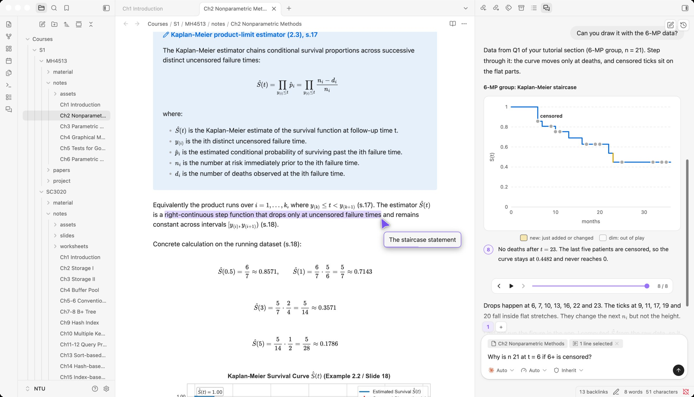
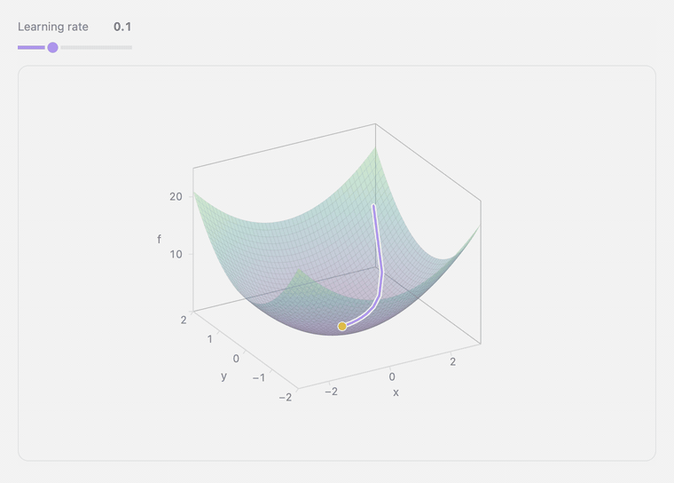
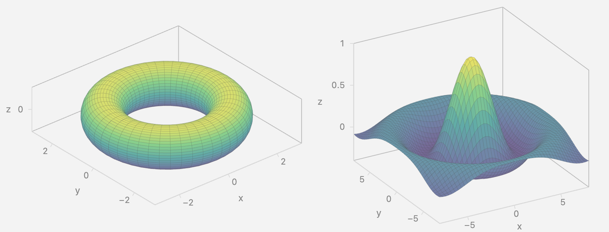
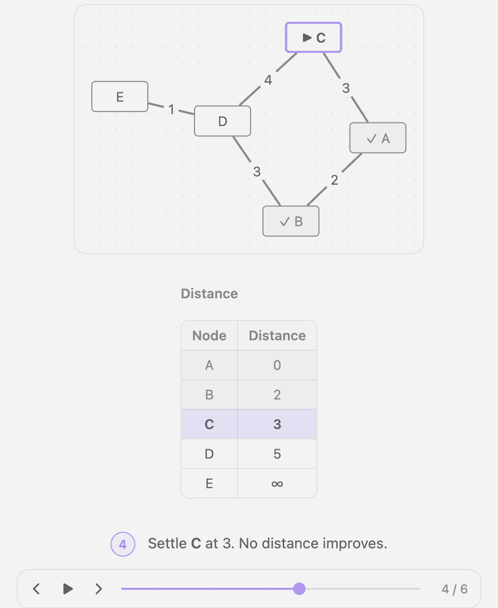
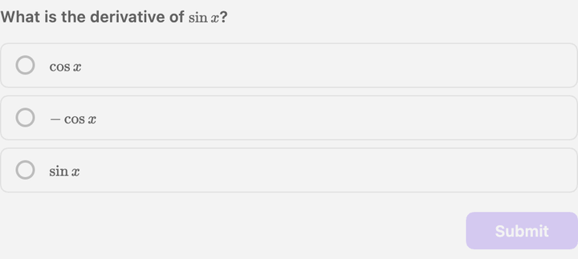
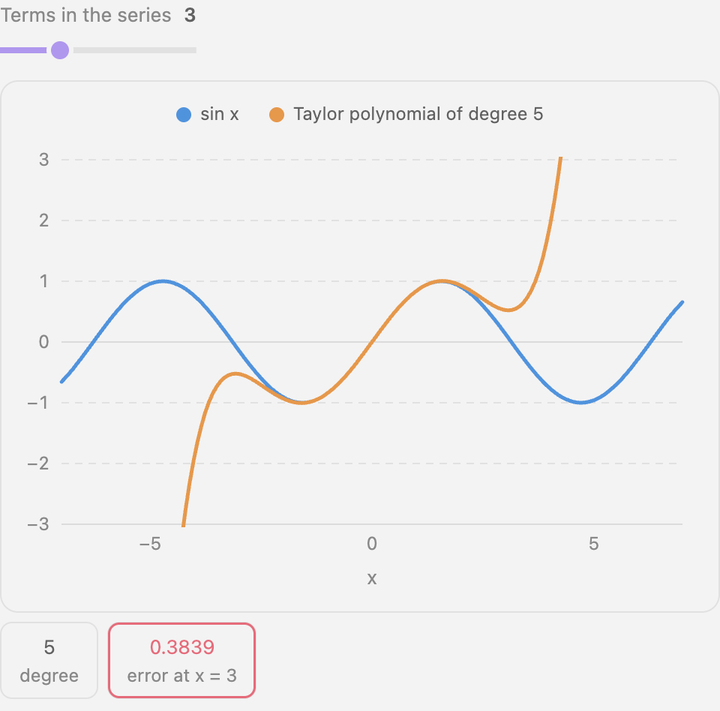
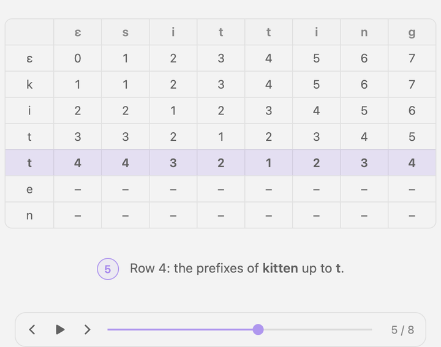
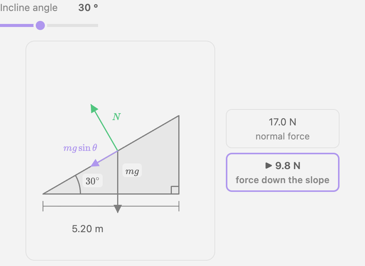

<h1 align="center">Clew</h1>

<p align="center"><strong>A visual-first study partner that sits beside your notes, points at the line it means, and draws what the note is missing.</strong></p>

<p align="center">
  
</p>

> [!WARNING]
> Clew is a work in progress and was developed out of a personal need. Expect missing features, rough edges, and breaking changes between versions. The project is not accepting contributions at this stage.

Clew is a desktop-only Obsidian plugin for studying university-level material. Open a note, open the chat beside it, and ask. The agent answers in the chat, highlights the sentence it means in your note, draws figures, visual walkthroughs that help illustrate a point.

Currently runs on the [Claude Code](https://code.claude.com) or [Codex](https://github.com/openai/codex) you already have installed, on your own subscription.

## Draw it, then turn it

<p align="center">
  
</p>

Ask about gradient descent, Clew answers with a surface you can interact with. Drag to rotate or move the learning-rate slider and the path redraws.

> The model never sends an image, instead it writes a short component in JSX-like syntax, and Clew runs it in a sandboxed worker and renders the result, so every figure takes your theme and stays interactive. For a 3D plot the program gives Clew a function `f = (x, y) => z`. Clew samples it, shades it by height, draws the box and ticks, and handles the rotation. A sphere or a torus uses `f = (u, v) => [x, y, z]` with a range for `u` and `v`.

<p align="center">
  
</p>

## Other figures

Clew draws these too.

<table>
  <tr>
    <td valign="top" width="50%">
      
      <br><br>
      
    </td>
    <td valign="top" width="50%">
      
      <br><br>
      
    </td>
  </tr>
</table>

- **Plots** in 2D and 3D. Drag a slider and the plot redraws.
- **Step-by-step walkthroughs** for algorithms, derivations, anything that changes state.
- **Graphs, tables and geometry** for computer science, accounting, business and maths: a shortest path, a depreciation schedule, a break-even plot, a triangle with its angles marked.
- **Quizzes.** Pick an answer and Clew marks it, then sends it back as your next message.
- **Maths** in TeX everywhere, and Mermaid for static diagrams.

<p align="center">
  
</p>

<details>
<summary>Code for the incline</summary>

```jsx
export const params = { angle: { label: 'Incline angle', min: 10, max: 60, step: 5, value: 30, unit: '°' } };

export default function ({ angle }) {
  const t = angle * Math.PI / 180, L = 6, m = 2, g = 9.8;
  const A = [0, 0], B = [L * Math.cos(t), 0], C = [L * Math.cos(t), L * Math.sin(t)];
  const P = along(A, C, 0.55);
  const W = m * g, N = W * Math.cos(t), F = W * Math.sin(t);
  const scale = 0.12;
  const tip = (v, k) => [P[0] + v[0] * k * scale, P[1] + v[1] * k * scale];
  return (
    <Row gap="md" align="center">
      <Diagram id="d" width={6} height={5.5}>
        <Shape pts={[A, B, C]} closed />
        <Angle at={A} from={B} to={C} label={'$' + angle + '^\\circ$'} />
        <RightAngle at={B} from={A} to={C} />
        <Vector from={P} to={tip([0, -1], W)} label="$mg$" />
        <Vector from={P} to={tip([-Math.sin(t), Math.cos(t)], N)} label="$N$" tag="good" />
        <Vector from={P} to={tip([-Math.cos(t), -Math.sin(t)], F)} label="$mg\sin\theta$" tag="active" />
        <Dimension from={A} to={B} label={(L * Math.cos(t)).toFixed(2) + ' m'} />
      </Diagram>
      <Column gap="sm">
        <Node id="n" label={N.toFixed(1) + ' N'} sub="normal force" />
        <Node id="f" label={F.toFixed(1) + ' N'} sub="force down the slope" tag="active" />
      </Column>
    </Row>
  );
}
```

The program places the triangle, the angle mark and the arrows from the angle, and works out the forces. Move the slider and Clew runs it again.

</details>

## Beside the note

- **Highlight and scroll.** The agent can mark a passage in the open note, or in another note of your vault, and walk you through several in order.
- **Quote into the chat.** Select text in the note and send it as the thing you are asking about.
- **Attach files and images.** Paste or drop an image, or mention a file from your vault.
- **Approvals.** A tool call that needs your permission shows an approval card.

Each message sends the open note and your selection. The agent can also read the rest of your vault with its own tools just like any coding agent.

## Requirements

- Obsidian 1.13 or later, on desktop
- Claude Code 2.1.113 or later, or Codex, installed and logged in

Clew runs your own installed CLI on your own subscription. It never collects or stores your credentials. To use your own API key instead, add it as an environment variable (for example `ANTHROPIC_API_KEY`) on the plugin's settings page. Clew keeps it in Obsidian's secret storage and passes it only to your CLI.

## Install from source

```bash
npm install
npm run build
```

Then copy `main.js`, `manifest.json` and `styles.css` into `<your vault>/.obsidian/plugins/clew/`, and enable Clew under Settings → Community plugins. If you set `OBSIDIAN_VAULT=/path/to/vault` in `.env.local`, `npm run build` copies the files for you.

Open the chat with **Clew: Open chat**. To see what figures look like without asking a model, run **Clew: Play visuals demo**.

## Development

```bash
npm run dev        # rebuild on change
npm run typecheck
npm test
```

## Roadmap

- [x] Chat with Claude Code or Codex beside your notes
- [x] Guided walkthroughs of the open note
- [x] Figures in the chat: plots, 3D surfaces, step-by-step boards, quizzes
- [x] File and image attachments
- [x] Tool approvals
- [ ] Evals and figure coverage
- [ ] Figures inside notes
- [ ] Publish to Obsidian Plugin Marketplace.
- [ ] Highlights in PDFs
- [ ] Memory and learning dependencies
- [ ] A live tutor that follows along as you study

## Credits

Parts of Clew are adapted from [Claudian](https://github.com/YishenTu/claudian) under the MIT License. See `THIRD_PARTY_NOTICES.md`.
