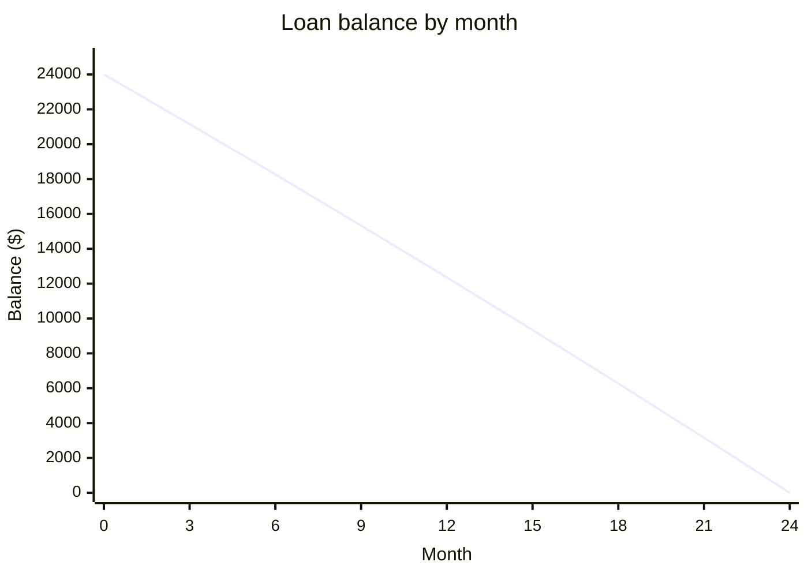

Monthly payment: **$1,063.69**, at 0.5% interest per month over 24 payments.

$$PMT = \frac{P\,r}{1-(1+r)^{-n}} = \frac{24000 \times 0.005}{1-1.005^{-24}} \approx 1063.69$$

| Month | Payment | Interest | Principal | Balance |
|---|---|---|---|---|
| 1 | 1,063.69 | 120.00 | 943.69 | 23,056.31 |
| 2 | 1,063.69 | 115.28 | 948.41 | 22,107.90 |
| 3 | 1,063.69 | 110.54 | 953.15 | 21,154.75 |
| 4 | 1,063.69 | 105.77 | 957.92 | 20,196.83 |
| 5 | 1,063.69 | 100.98 | 962.71 | 19,234.12 |
| 6 | 1,063.69 | 96.17 | 967.52 | 18,266.60 |
| 7 | 1,063.69 | 91.33 | 972.36 | 17,294.24 |
| 8 | 1,063.69 | 86.47 | 977.22 | 16,317.02 |
| 9 | 1,063.69 | 81.59 | 982.10 | 15,334.92 |
| 10 | 1,063.69 | 76.67 | 987.02 | 14,347.90 |
| 11 | 1,063.69 | 71.74 | 991.95 | 13,355.95 |
| 12 | 1,063.69 | 66.78 | 996.91 | 12,359.04 |
| 13 | 1,063.69 | 61.80 | 1,001.89 | 11,357.15 |
| 14 | 1,063.69 | 56.79 | 1,006.90 | 10,350.25 |
| 15 | 1,063.69 | 51.75 | 1,011.94 | 9,338.31 |
| 16 | 1,063.69 | 46.69 | 1,017.00 | 8,321.31 |
| 17 | 1,063.69 | 41.61 | 1,022.08 | 7,299.23 |
| 18 | 1,063.69 | 36.50 | 1,027.19 | 6,272.04 |
| 19 | 1,063.69 | 31.36 | 1,032.33 | 5,239.71 |
| 20 | 1,063.69 | 26.20 | 1,037.49 | 4,202.22 |
| 21 | 1,063.69 | 21.01 | 1,042.68 | 3,159.54 |
| 22 | 1,063.69 | 15.80 | 1,047.89 | 2,111.65 |
| 23 | 1,063.69 | 10.56 | 1,053.13 | 1,058.52 |
| 24 | 1,063.81 | 5.29 | 1,058.52 | 0.00 |

Total interest: $1,528.68. Total paid: $25,528.68. The final payment is $0.12 higher to clear the rounding.

Not checked: your lender's rounding and day-count rules. Risk: if the lender uses a different rate basis, every row changes.