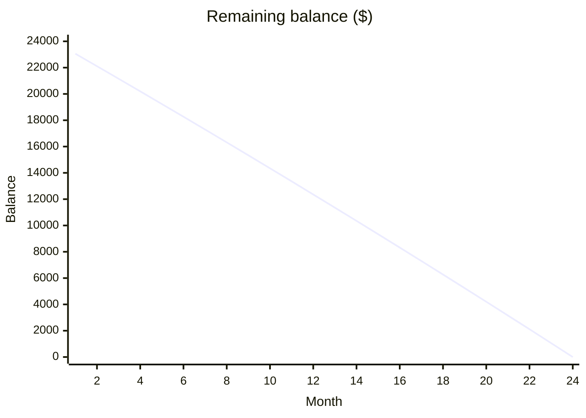

**Monthly payment: $1,063.70.** Total interest: $1,528.66.

Payment = P·r / (1 − (1 + r)⁻ⁿ), with r = 0.06 / 12 = 0.005 and n = 24.

| Month | Payment | Interest | Principal | Balance |
|---|---|---|---|---|
| 1 | 1,063.70 | 120.00 | 943.70 | 23,056.30 |
| 2 | 1,063.70 | 115.28 | 948.42 | 22,107.88 |
| 3 | 1,063.70 | 110.54 | 953.16 | 21,154.72 |
| 4 | 1,063.70 | 105.77 | 957.93 | 20,196.79 |
| 5 | 1,063.70 | 100.98 | 962.72 | 19,234.07 |
| 6 | 1,063.70 | 96.17 | 967.53 | 18,266.54 |
| 7 | 1,063.70 | 91.33 | 972.37 | 17,294.17 |
| 8 | 1,063.70 | 86.47 | 977.23 | 16,316.94 |
| 9 | 1,063.70 | 81.58 | 982.12 | 15,334.82 |
| 10 | 1,063.70 | 76.67 | 987.03 | 14,347.79 |
| 11 | 1,063.70 | 71.74 | 991.96 | 13,355.83 |
| 12 | 1,063.70 | 66.78 | 996.92 | 12,358.91 |
| 13 | 1,063.70 | 61.79 | 1,001.91 | 11,357.00 |
| 14 | 1,063.70 | 56.79 | 1,006.91 | 10,350.09 |
| 15 | 1,063.70 | 51.75 | 1,011.95 | 9,338.14 |
| 16 | 1,063.70 | 46.69 | 1,017.01 | 8,321.13 |
| 17 | 1,063.70 | 41.61 | 1,022.09 | 7,299.04 |
| 18 | 1,063.70 | 36.50 | 1,027.20 | 6,271.84 |
| 19 | 1,063.70 | 31.36 | 1,032.34 | 5,239.50 |
| 20 | 1,063.70 | 26.20 | 1,037.50 | 4,202.00 |
| 21 | 1,063.70 | 21.01 | 1,042.69 | 3,159.31 |
| 22 | 1,063.70 | 15.80 | 1,047.90 | 2,111.41 |
| 23 | 1,063.70 | 10.56 | 1,053.14 | 1,058.27 |
| 24 | 1,063.56 | 5.29 | 1,058.27 | 0.00 |

Interest is rounded to the cent each month. The final payment is $0.14 smaller to clear the balance.

Not checked: your lender's rounding rule. A lender that truncates interest instead of rounding will shift the cents in some rows.