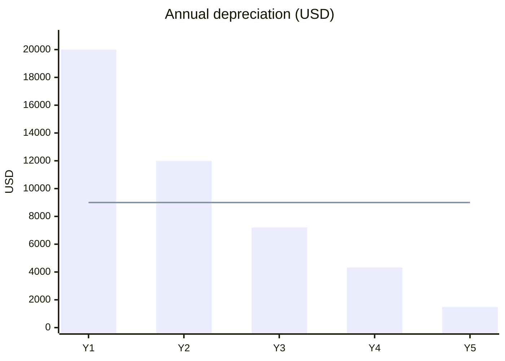

Both methods depreciate **$45,000** ($50,000 cost minus $5,000 salvage) over 5 years. Straight-line charges $9,000 each year. DDB charges 40% of the opening book value each year (2 ÷ 5 = 40%).

| Year | Straight-line expense | SL book value | DDB expense | DDB book value |
|------|------------------:|------------:|------------:|------------:|
| 0 | | 50,000 | | 50,000 |
| 1 | 9,000 | 41,000 | 20,000 | 30,000 |
| 2 | 9,000 | 32,000 | 12,000 | 18,000 |
| 3 | 9,000 | 23,000 | 7,200 | 10,800 |
| 4 | 9,000 | 14,000 | 4,320 | 6,480 |
| 5 | 9,000 | 5,000 | 1,480 | 5,000 |
| **Total** | **45,000** | | **45,000** | |

Year 5 DDB uses a limit. 40% of 6,480 is 2,592, but book value cannot fall below salvage. So Year 5 expense is 6,480 − 5,000 = 1,480.

- DDB charges more than straight-line in Years 1 and 2, and less from Year 3 on.
- Cumulative DDB expense stays ahead through Year 4 (43,520 vs 36,000), then both reach 45,000.
- DDB lowers early reported profit. It suits assets that lose value fast.

Not checked: tax depreciation rules, such as US MACRS, which differ from these book methods. Partial-year timing conventions are also not covered.