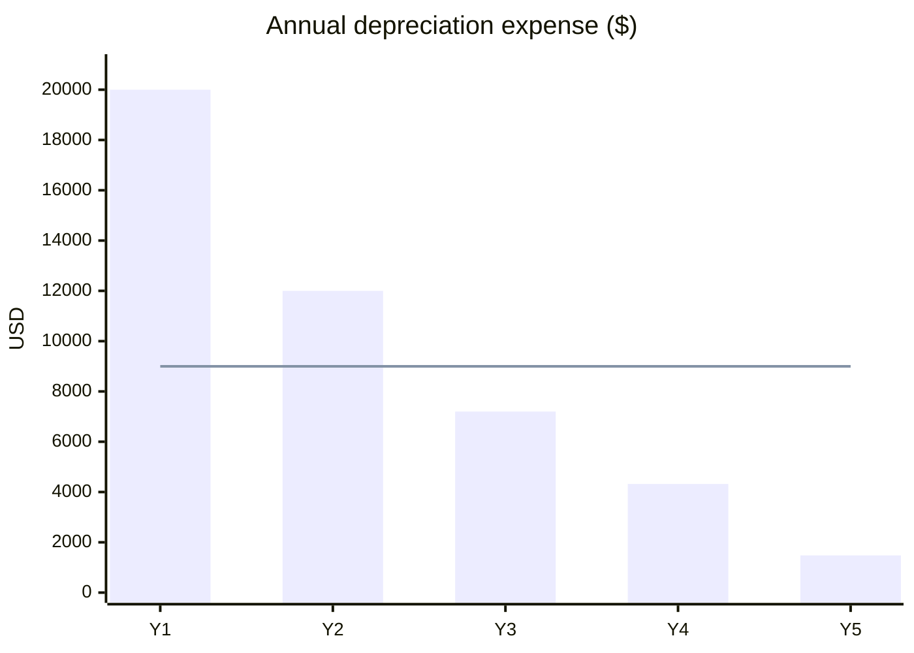

Both methods depreciate the same $45,000 ($50,000 cost minus $5,000 salvage) over 5 years. Straight-line spreads it evenly. Double-declining-balance (DDB) takes more early and less late.

| Year | SL expense | SL book value | DDB expense | DDB book value |
|---|---|---|---|---|
| 0 | | 50,000 | | 50,000 |
| 1 | 9,000 | 41,000 | 20,000 | 30,000 |
| 2 | 9,000 | 32,000 | 12,000 | 18,000 |
| 3 | 9,000 | 23,000 | 7,200 | 10,800 |
| 4 | 9,000 | 14,000 | 4,320 | 6,480 |
| 5 | 9,000 | 5,000 | 1,480 | 5,000 |
| Total | 45,000 | | 45,000 | |

**Working**

- SL: (50,000 − 5,000) / 5 = 9,000 per year.
- DDB rate: 2 / 5 = 40%, applied to the start-of-year book value. Salvage is ignored until the cap applies.
  - Year 1: 50,000 × 0.40 = 20,000
  - Year 2: 30,000 × 0.40 = 12,000
  - Year 3: 18,000 × 0.40 = 7,200
  - Year 4: 10,800 × 0.40 = 4,320
  - Year 5: 6,480 × 0.40 = 2,592, but that drops book value to 3,888, below salvage. Cap it at 6,480 − 5,000 = 1,480.

**Key differences**

- DDB is higher in years 1 and 2 (+11,000 and +3,000). It is lower in years 3 to 5 (−1,800, −4,680, −7,520).
- DDB falls below the flat 9,000 in year 3.
- Cumulative expense after year 2: SL 18,000, DDB 32,000.
- Use DDB when the asset loses value fast, such as computers or vehicles. Use SL when use is even over time.

I did not check tax rules. US tax depreciation (MACRS) replaces both methods for tax filing. Risk: skipping the year 5 cap takes book value below the $5,000 salvage.