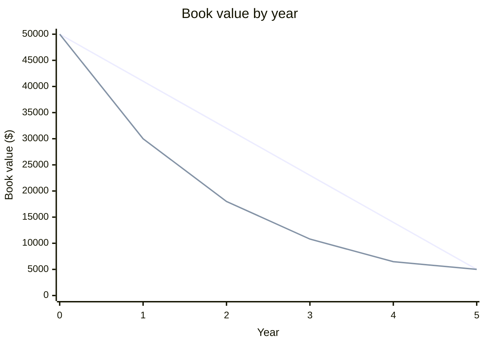

Straight-line spreads the cost evenly over the asset's life. Double-declining-balance (DDB) takes a larger expense early and a smaller one later. Both stop at the salvage value.

## Straight-line

Straight-line gives the same expense every year. The annual expense is the **depreciable base** (cost minus salvage) divided by the useful life:

$$D = \frac{C - S}{n}$$

Here $C$ is the cost, $S$ is the salvage value, and $n$ is the useful life in years.

For $C = 50{,}000$, $S = 5{,}000$, $n = 5$: $D = \frac{45{,}000}{5} = 9{,}000$ per year.

## Double-declining-balance

DDB uses twice the straight-line rate, $r = \frac{2}{n}$, applied to the **book value** at the start of each year. The book value is the cost minus the depreciation taken so far. Book value must not fall below $S$, so the last year is capped.

For $r = \frac{2}{5} = 40\%$:

- Year 1: $0.40 \times 50{,}000 = 20{,}000$. Book value becomes $30{,}000$.
- Year 4: $0.40 \times 10{,}800 = 4{,}320$. Book value becomes $6{,}480$.
- Year 5: the formula gives $0.40 \times 6{,}480 = 2{,}592$, which would drop book value to $3{,}888$, below salvage. So the expense is capped at $6{,}480 - 5{,}000 = 1{,}480$.

## Side by side

| Year | Straight-line expense | Straight-line book value | DDB expense | DDB book value |
|---|---|---|---|---|
| 0 | | 50,000 | | 50,000 |
| 1 | 9,000 | 41,000 | 20,000 | 30,000 |
| 2 | 9,000 | 32,000 | 12,000 | 18,000 |
| 3 | 9,000 | 23,000 | 7,200 | 10,800 |
| 4 | 9,000 | 14,000 | 4,320 | 6,480 |
| 5 | 9,000 | 5,000 | 1,480 | 5,000 |

Both methods total $45{,}000$.

Use DDB for assets that lose value fast early, such as computers and vehicles. DDB does not suit an asset that wears evenly over time.