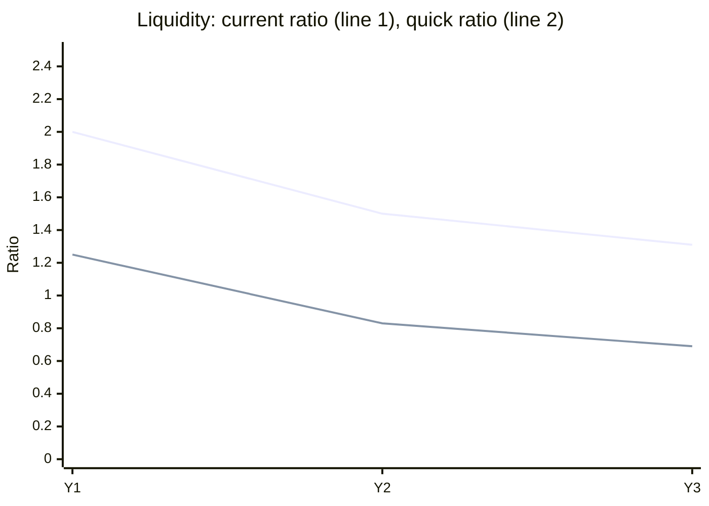

Ratios, Y1 to Y3 (year-end balances):

| Ratio | Formula | Y1 | Y2 | Y3 | Y1 to Y3 change |
|---|---|---|---|---|---|
| Current ratio | CA / CL | 2.00 | 1.50 | 1.31 | -0.69 |
| Quick ratio | (CA - Inventory) / CL | 1.25 | 0.83 | 0.69 | -0.56 |
| Working capital | CA - CL | 200 | 150 | 90 | -110 |
| Net profit margin | NI / Revenue | 10.0% | 6.9% | 3.1% | -6.9 pts |
| Asset turnover | Revenue / Total assets | 0.67 | 0.65 | 0.61 | -0.06 |
| ROA | NI / Total assets | 6.7% | 4.5% | 1.9% | -4.8 pts |
| ROE | NI / Equity | 12.0% | 8.7% | 3.9% | -8.1 pts |
| Debt to equity | (TA - Equity) / Equity | 0.80 | 0.92 | 1.06 | +0.26 |
| Equity ratio | Equity / TA | 55.6% | 52.0% | 48.6% | -7.0 pts |
| Equity multiplier | TA / Equity | 1.80 | 1.92 | 2.06 | +0.26 |

Readings:
- Liquidity fell. Quick ratio is below 1.0 in Y2 and Y3, so non-inventory current assets no longer cover current liabilities.
- Profit fell while revenue held near 640. Net income dropped from 60 to 20.
- Leverage rose. Liabilities went from 400 to 540, and the equity multiplier from 1.80 to 2.06.
- Equity fell in Y2 and Y3 even with positive net income. Equity moved by -25 in Y2 and -30 in Y3 beyond net income, which points to dividends or other equity changes. Confirm with the source statements.

Skipped: inventory turnover and days inventory (need cost of goods sold, not given), and average-balance versions of ROA and ROE. Risk: liabilities are derived as total assets minus equity, so the debt ratios are wrong if there are other claims outside both.