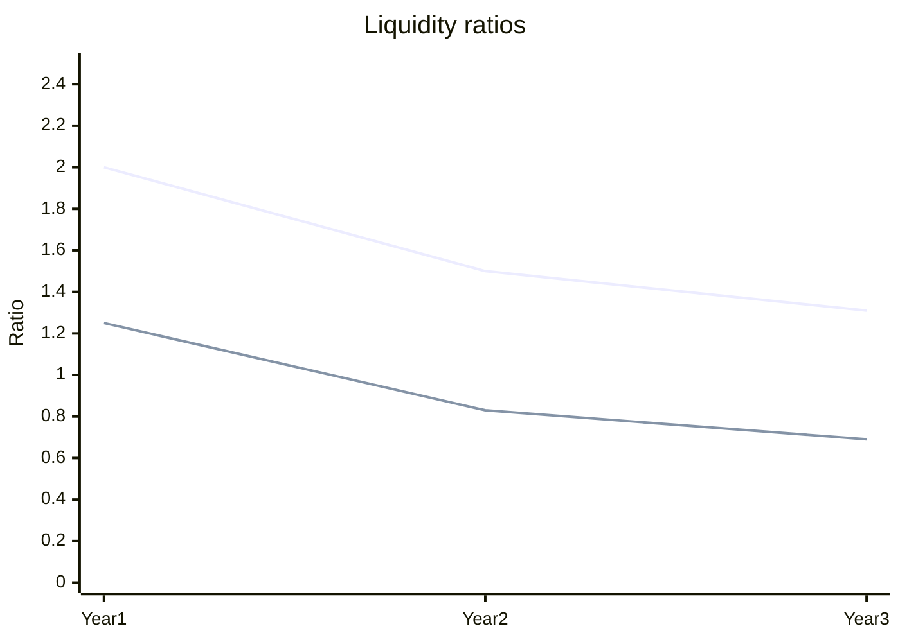

All eight ratios got worse from Year 1 to Year 3.

| Ratio | Formula | Year 1 | Year 2 | Year 3 | Change Y1→Y3 |
|---|---|---|---|---|---|
| Current ratio | CA / CL | 2.00 | 1.50 | 1.31 | -0.69 |
| Quick ratio | (CA - Inventory) / CL | 1.25 | 0.83 | 0.69 | -0.56 |
| Net profit margin | Net income / Revenue | 10.0% | 6.9% | 3.1% | -6.9 pts |
| ROA | Net income / Total assets | 6.7% | 4.5% | 1.9% | -4.8 pts |
| ROE | Net income / Equity | 12.0% | 8.7% | 3.9% | -8.1 pts |
| Asset turnover | Revenue / Total assets | 0.67 | 0.65 | 0.61 | -0.06 |
| Debt-to-equity | (Total assets - Equity) / Equity | 0.80 | 0.92 | 1.06 | +0.26 (worse) |
| Equity ratio | Equity / Total assets | 55.6% | 52.0% | 48.6% | -7.0 pts |

Current ratio is the top line, quick ratio the bottom line. Quick ratio fell below 1.0 in Year 2.

Assumptions:
- Columns run oldest to newest. If they run newest first, every trend reverses.
- Total liabilities = total assets - equity.

Skipped: ROA and ROE use year-end balances, not averages. Inventory turnover is not shown because it needs cost of sales.