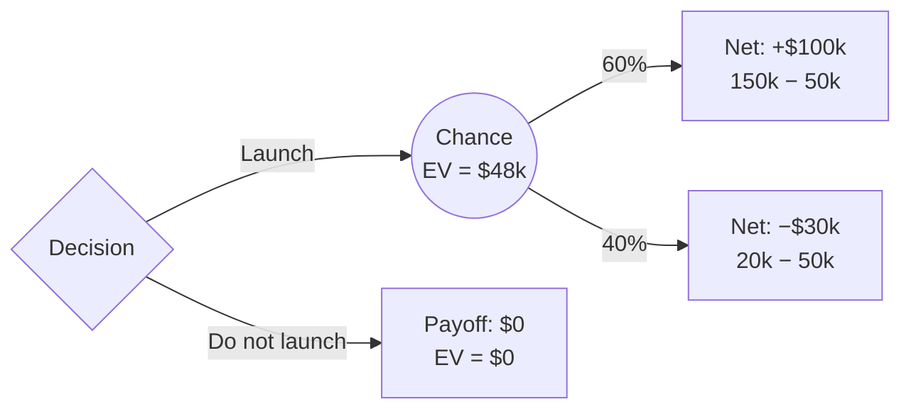

**Launch.** Expected value is **$48k**, against **$0** for not launching.

I read $150k and $20k as gross returns, with the $50k cost paid in both launch outcomes.

Calculation:

$$EV_{\text{launch}} = 0.6(150 - 50) + 0.4(20 - 50) = 60 - 12 = 48$$

Same result without netting per branch: $0.6(150) + 0.4(20) - 50 = 98 - 50 = 48$ ($k).

Not checked: discounting, risk aversion, and any cost beyond the $50k. The main risk is the 40% branch, which loses $30k net.