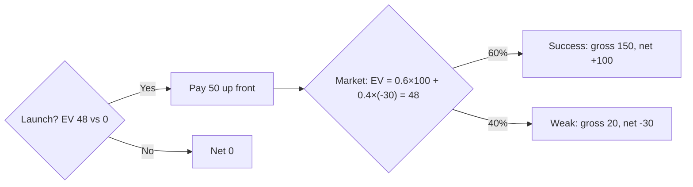

**Launch.** Expected net value is **+48k** (in $ thousands: +48), versus **0** for not launching.

Launch EV = 0.6 × 100 + 0.4 × (-30) = 60 - 12 = 48. Not launch EV = 0.

Not checked: I assumed $150k and $20k are gross returns and the $50k cost is paid in both outcomes. If the $150k and $20k already include the cost, the launch EV is 98 instead of 48, and the decision is the same.