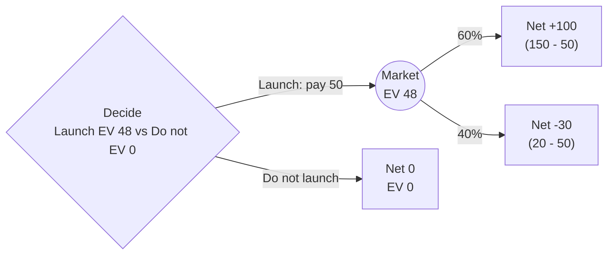

**Launch.** Expected value is 48k, against 0 for not launching.

I read the $150k and $20k as gross returns, with the $50k cost paid up front. All values below are in thousands of dollars.

EV(launch) = 0.6 × 150 + 0.4 × 20 − 50 = 90 + 8 − 50 = **48**

Launch stays positive while the chance of the $150k outcome is at least 23%. Solve 130p - 30 = 0 for p.

If the $150k and $20k are already net of the $50k, EV is 98k and the verdict does not change.

Not checked: the 60/40 odds are taken as given, and the EV assumes you are risk-neutral. The main risk is the 40% chance of a net loss of 30k.