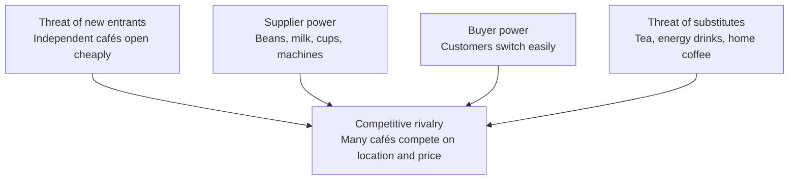

| Force | Level | Coffee chain reason |
|---|---|---|
| Threat of new entrants | High | Small cafés need little capital. Chain stores need more. |
| Supplier power | Medium | Beans come from few large traders, so prices swing. Milk and cups are common goods. |
| Buyer power | Medium to high | Customers pay little to switch. Loyalty apps reduce this. |
| Threat of substitutes | High | Tea, energy drinks and home coffee machines replace a café visit. |
| Competitive rivalry | High | Many cafés compete on the same locations, drinks and prices. |

Skipped: market size, local competitor data and financials. Not checked: your target market. These levels are general, so check them against local data before you use them in a decision.