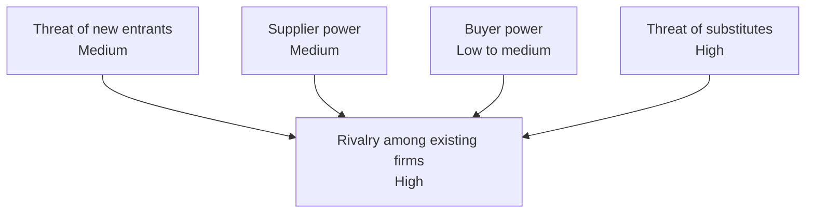

| Force | Rating | Coffee chain driver |
|---|---|---|
| New entrants | Medium | Espresso equipment is cheap and small sites are easy to lease. Brand, prime locations, and store capex slow entry. |
| Supplier power | Medium | Few large bean roasters and dairy distributors. Green coffee prices swing. |
| Buyer power | Low to medium | Many options and low switching cost. Loyalty apps reduce this. |
| Substitutes | High | Home brewing, tea, energy drinks, instant coffee. |
| Rivalry | High | Starbucks, Dunkin, independents, and convenience stores compete for the same sites and customers. |

Not checked: local market data. The ratings are generic, so set them with your own store and competitor data.