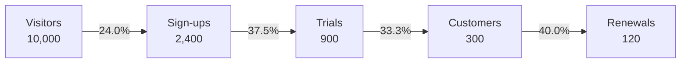

| Stage | Count | From previous stage | From visitors |
|---|---|---|---|
| Visitors | 10,000 | — | 100% |
| Sign-ups | 2,400 | 24.0% | 24.0% |
| Trials | 900 | 37.5% | 9.0% |
| Customers | 300 | 33.3% | 3.0% |
| Renewals | 120 | 40.0% | 1.2% |

Largest loss: visitors to sign-ups, 7,600 lost (76%).

Not checked: whether the 120 renewals come from the same 300 customers in the same period. The rates assume they do.