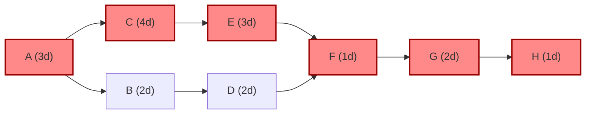

Project length is **14 days**. Critical path: **A → C → E → F → G → H**.

| Task | Dur (d) | Depends on | ES | EF | LS | LF | Float |
|------|---------|------------|----|----|----|----|-------|
| A | 3 | none | 0 | 3 | 0 | 3 | 0 |
| B | 2 | A | 3 | 5 | 6 | 8 | 3 |
| C | 4 | A | 3 | 7 | 3 | 7 | 0 |
| D | 2 | B | 5 | 7 | 8 | 10 | 3 |
| E | 3 | C | 7 | 10 | 7 | 10 | 0 |
| F | 1 | D, E | 10 | 11 | 10 | 11 | 0 |
| G | 2 | F | 11 | 13 | 11 | 13 | 0 |
| H | 1 | G | 13 | 14 | 13 | 14 | 0 |

B and D can slip 3 days without moving the finish. A slip on any critical task moves the finish.

Not checked: calendar dates, weekends, and resource limits. Assumes finish-to-start links with no lag.