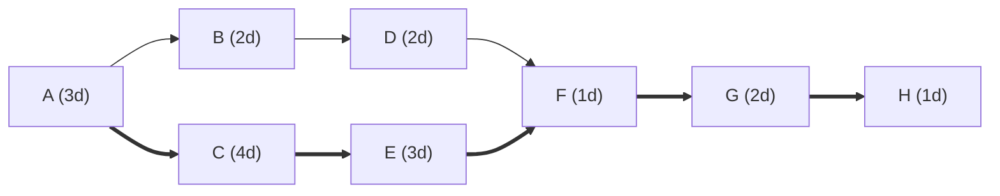

**Critical path: A → C → E → F → G → H. Project length: 14 days.**

| Task | Dur | After | ES | EF | LS | LF | Float | Critical |
|---|---|---|---|---|---|---|---|---|
| A | 3 | none | 0 | 3 | 0 | 3 | 0 | Yes |
| B | 2 | A | 3 | 5 | 6 | 8 | 3 | No |
| C | 4 | A | 3 | 7 | 3 | 7 | 0 | Yes |
| D | 2 | B | 5 | 7 | 8 | 10 | 3 | No |
| E | 3 | C | 7 | 10 | 7 | 10 | 0 | Yes |
| F | 1 | D, E | 10 | 11 | 10 | 11 | 0 | Yes |
| G | 2 | F | 11 | 13 | 11 | 13 | 0 | Yes |
| H | 1 | G | 13 | 14 | 13 | 14 | 0 | Yes |

ES/EF are earliest start and finish. LS/LF are latest start and finish. Float = LS − ES. B and D can each slip 3 days without moving the finish date.

Thick arrows mark the critical path. Day 0 is the project start.

Not checked: resource limits and calendar dates. Any delay in A, C, E, F, G or H moves the finish.