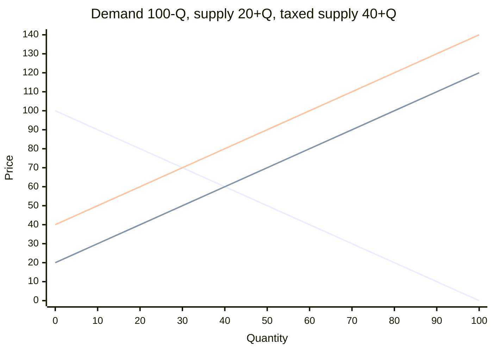

**Result:** The tax cuts sales from 40 to 30 units. Buyers pay 70, and sellers keep 50. The deadweight loss is **100**.

**How the tax shifts supply**

The seller pays the tax on each unit. To supply any quantity, the seller needs the same net price as before, so the buyer price must rise by the tax. The supply curve shifts up by $t$:

$$P_{\text{buyer}} = P_{\text{seller}} + t$$

With $P_{\text{seller}} = 20 + Q$ and $t = 20$, the taxed supply curve is $P_{\text{buyer}} = 40 + Q$.

**Steps**

1. Before the tax: $100 - Q = 20 + Q$, so $Q = 40$ and $P = 60$.
2. After the tax: $100 - Q = 40 + Q$, so $Q = 30$. Buyer price is $100 - 30 = 70$. Seller net price is $70 - 20 = 50$. Check: $20 + 30 = 50$.
3. Tax revenue: $20 \times 30 = 600$.
4. Deadweight loss: the gap between the curves is $(100 - Q) - (20 + Q) = 80 - 2Q$. It falls from 20 at $Q = 30$ to 0 at $Q = 40$. The lost triangle has base 10 and height 20, so $\tfrac12 \times 10 \times 20 = 100$.

| | Before | After |
|---|---|---|
| Quantity | 40 | 30 |
| Buyer price | 60 | 70 |
| Seller net price | 60 | 50 |
| Consumer surplus | 800 | 450 |
| Producer surplus | 800 | 450 |
| Tax revenue | 0 | 600 |
| Total surplus | 1600 | 1500 |

The total surplus loss is 100, which matches the deadweight loss.

Buyers and sellers each bear 10 of the 20 tax. The slopes are equal, so the split is even.

Not checked: a tax levied on buyers instead of sellers. It should give the same $Q = 30$ and prices.