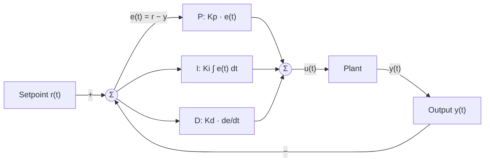

The error e(t) feeds the P, I and D blocks in parallel. Their sum u(t) drives the plant. The output is fed back and subtracted at the first summing junction.

Not checked: rendering in the Obsidian vault. Risk: none for the diagram itself.