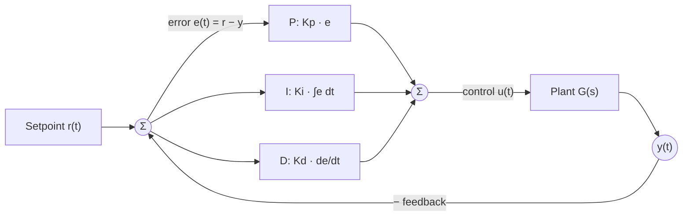

The first Σ forms the error. The P, I and D terms each act on that error. Their outputs add at the second Σ, which gives the control signal. The plant output y(t) returns to the first Σ.

$$u(t) = K_p\,e(t) + K_i\int_0^t e(\tau)\,d\tau + K_d\,\frac{de(t)}{dt}$$

Skipped: the disturbance input into the plant, and integral anti-windup for actuator saturation. Both change the diagram if your system has them.