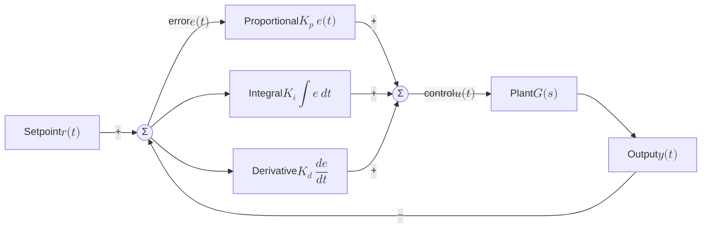

The controller output is the sum of three terms:

$$u(t) = K_p\,e(t) + K_i \int_0^t e(\tau)\,d\tau + K_d\,\frac{de(t)}{dt}$$

- $e(t) = r(t) - y(t)$ is the error.
- $K_p$, $K_i$, $K_d$ are the gains.