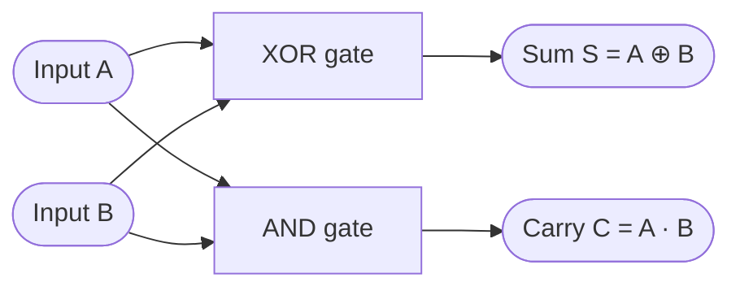

A half adder uses two gates: an XOR gate for the sum and an AND gate for the carry.

| A | B | S (Sum) | C (Carry) |
|---|---|---------|-----------|
| 0 | 0 | 0 | 0 |
| 0 | 1 | 1 | 0 |
| 1 | 0 | 1 | 0 |
| 1 | 1 | 0 | 1 |

Not checked: how the diagram renders in your viewer. Skipped: a NAND-only version.