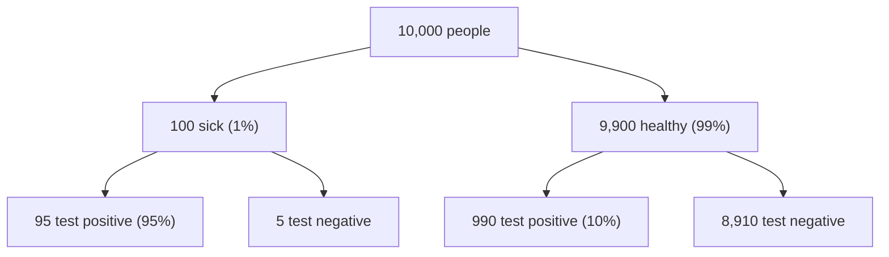

Most positives are false alarms because healthy people outnumber sick people about 99 to 1. Even a small error rate, applied to the large healthy group, produces more false positives than the sick group produces true positives.

Count 10,000 people:

There are 1,085 positives in total: 95 sick people and 990 healthy people. So a positive result comes from a sick person in 95 of 1,085 cases.

Bayes' theorem gives the chance of disease $D$ given a positive test $+$. It is the chance of the positive result among the sick, times the prevalence, divided by the chance of any positive result:

$$P(D \mid +) = \frac{P(+ \mid D)\,P(D)}{P(+)}$$

The chance of any positive has two parts, sick and healthy:

$$P(+) = P(+ \mid D)\,P(D) + P(+ \mid \neg D)\,P(\neg D)$$

Here:
- $P(D) = 0.01$ (prevalence), so $P(\neg D) = 0.99$
- $P(+ \mid D) = 0.95$ (sensitivity)
- $P(+ \mid \neg D) = 1 - 0.90 = 0.10$ (false positive rate)

$$P(+) = 0.95(0.01) + 0.10(0.99) = 0.0095 + 0.099 = 0.1085$$

$$P(D \mid +) = \frac{0.95(0.01)}{0.1085} = \frac{0.0095}{0.1085} \approx 0.088$$

A positive test means an 8.8% chance of disease. The chance of a false alarm is 91.2%.

The result depends on prevalence. At 50% prevalence, the same test gives $\frac{0.475}{0.525} \approx 0.905$, so a positive means about 90% disease.

Not checked: repeat testing and other populations. Risk: the 1% prevalence is an assumption, so use the real rate for the population you test.