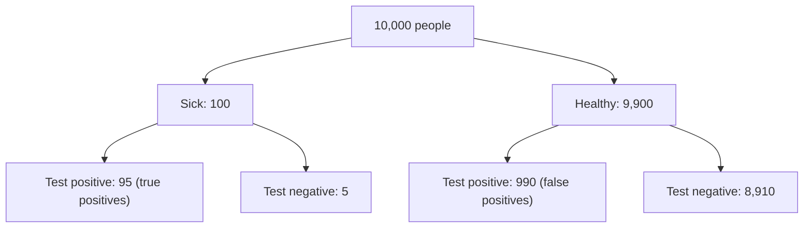

A positive result is probably false. About 91 of every 100 positives come from healthy people. The 1% prevalence causes this. Healthy people are so many that a 10% false-positive rate on them outweighs the 95 sick people the test finds.

**Count 10,000 people:**

- 100 people are sick. The test finds 95.
- 9,900 people are healthy. The test wrongly flags 990 of them.
- Positives: 95 + 990 = 1,085. Only 95 of these are sick.

**The rule.** The chance that a positive means disease is the positive predictive value. Bayes' theorem gives it:

$$P(D \mid +) = \frac{P(+ \mid D)\,P(D)}{P(+ \mid D)\,P(D) + P(+ \mid \neg D)\,P(\neg D)}$$

- $P(D \mid +)$: chance of disease, given a positive test.
- $P(+ \mid D) = 0.95$: sensitivity.
- $P(D) = 0.01$: prevalence.
- $P(+ \mid \neg D) = 1 - 0.90 = 0.10$: false-positive rate.
- $P(\neg D) = 0.99$: chance of being healthy.

**Worked example:**

$$P(D \mid +) = \frac{0.95 \times 0.01}{0.95 \times 0.01 + 0.10 \times 0.99} = \frac{0.0095}{0.1085} \approx 0.088$$

Only 8.8% of positives are sick. The other 91.2% are false alarms, which matches 990 out of 1,085 in the count.

The 8.8% depends on the 1% prevalence. In a group where half the people are sick, the same test is right about 90% of the time.

Not checked: real error rates for your population. Do not use these figures for a diagnosis without a clinician.