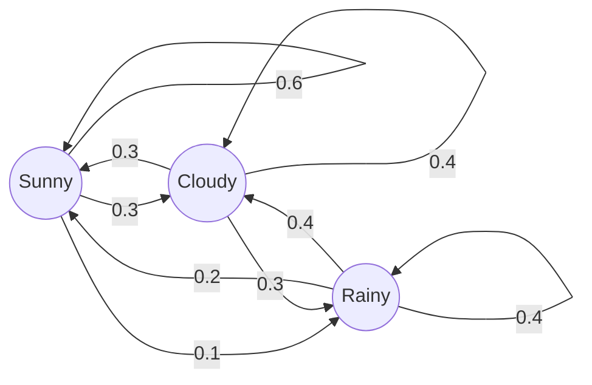

A **Markov chain** is a process that moves between states, where tomorrow's state depends only on today's. Each day's move is random, but its odds come from one fixed table, the transition matrix. You can forecast days ahead from that table alone.

Formally, the chain is a sequence $X_0, X_1, X_2, \dots$ of states from a finite set, such that

$$P(X_{n+1}=j \mid X_n=i, X_{n-1}, \dots, X_0) = P(X_{n+1}=j \mid X_n=i) = P_{ij}$$

where $P_{ij}$ is the chance of moving from state $i$ to state $j$ in one day, and $P_{ij}$ does not change with $n$. Each row of $P$ sums to 1. For this weather chain, with states ordered Sunny, Cloudy, Rainy:

$$P = \begin{pmatrix} 0.6 & 0.3 & 0.1 \\ 0.3 & 0.4 & 0.3 \\ 0.2 & 0.4 & 0.4 \end{pmatrix}$$

## The chain

## Day by day from sunny

Let $\pi_n = (\pi_n(S), \pi_n(C), \pi_n(R))$ be the chance of each weather on day $n$. One day of change is

$$\pi_{n+1} = \pi_n P$$

Start sunny: $\pi_0 = (1, 0, 0)$. Then $\pi_1 = (0.6, 0.3, 0.1)$, the Sunny row of $P$. For day 2, multiply $\pi_1$ by each column of $P$:

$$\begin{aligned} \pi_2(S) &= 0.6(0.6) + 0.3(0.3) + 0.1(0.2) = 0.47 \\ \pi_2(C) &= 0.6(0.3) + 0.3(0.4) + 0.1(0.4) = 0.34 \\ \pi_2(R) &= 0.6(0.1) + 0.3(0.3) + 0.1(0.4) = 0.19 \end{aligned}$$

Day 3 sunny, using $\pi_2$: $0.47(0.6) + 0.34(0.3) + 0.19(0.2) = 0.422$. The same column rule gives the rest.

| Day | Sunny | Cloudy | Rainy |
|---|---|---|---|
| 0 | 1.000 | 0.000 | 0.000 |
| 1 | 0.600 | 0.300 | 0.100 |
| 2 | 0.470 | 0.340 | 0.190 |
| 3 | 0.422 | 0.353 | 0.225 |
| 4 | 0.404 | 0.358 | 0.238 |
| 5 | 0.397 | 0.360 | 0.243 |

Each row sums to 1.

## Where it settles

The values drift toward $\pi = (24/61, 22/61, 15/61) \approx (0.393, 0.361, 0.246)$, the solution of $\pi = \pi P$ with entries summing to 1. By day 5, Sunny is within 0.004 of this.

The model assumes the same table every day and that only today matters. Real weather depends on more history, so the forecast is weaker past a few days.