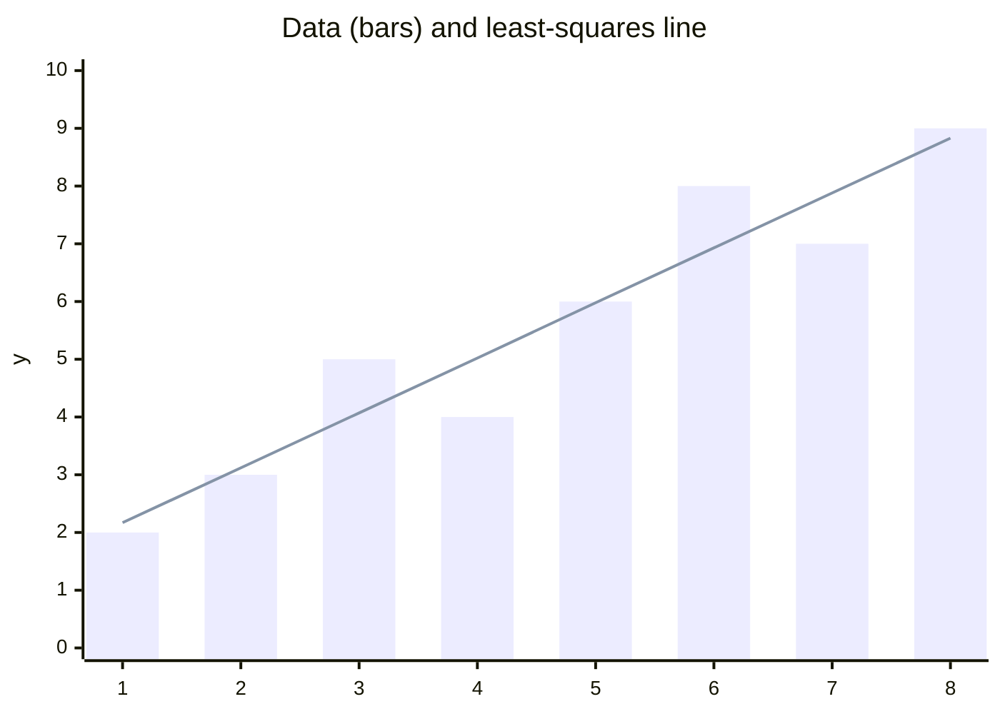

**Least-squares line:** $\hat{y} = \frac{20}{21}x + \frac{17}{14} \approx 0.952x + 1.214$

Sums: $\bar{x} = 4.5$, $\bar{y} = 5.5$, $S_{xx} = 42$, $S_{xy} = 40$. So slope $= 40/42$ and intercept $= 5.5 - (40/42)(4.5) = 17/14$.

| x | y | ŷ | residual (y − ŷ) |
|---|---|---|---|
| 1 | 2 | 2.167 | −0.167 |
| 2 | 3 | 3.119 | −0.119 |
| 3 | 5 | 4.071 | 0.929 |
| 4 | 4 | 5.024 | −1.024 |
| 5 | 6 | 5.976 | 0.024 |
| 6 | 8 | 6.929 | 1.071 |
| 7 | 7 | 7.881 | −0.881 |
| 8 | 9 | 8.833 | 0.167 |

Residuals sum to 0. Sum of squared residuals is $82/21 \approx 3.905$. $R^2 \approx 0.907$.

Largest residual is at x = 4 (−1.024), the point furthest below the line.

Not checked: I did not run a script. Values were computed by hand and cross-checked (residuals sum to 0; SSE matches $\sum y^2 - a\sum y - b\sum xy$). The chart is a bar-and-line view, not a true scatter plot, because the renderer has no scatter type.