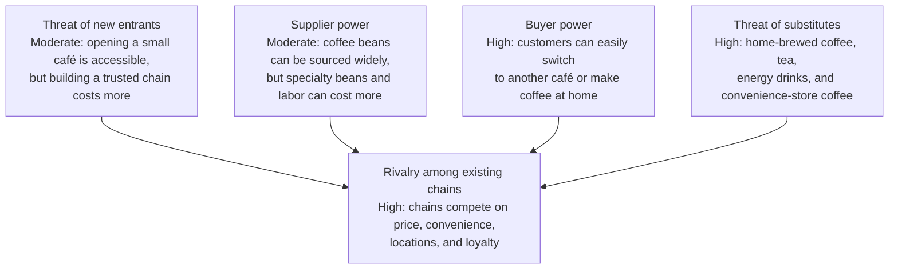

Porter’s five forces show the pressures that shape competition and profits in an industry. For a coffee shop chain:

The ratings are typical examples; they can differ by location and market segment.

