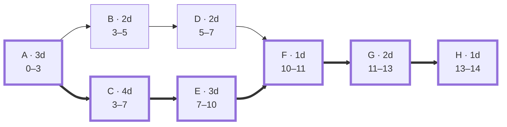

The project takes **14 days**. Its critical path is **A → C → E → F → G → H**.

| Activity | Duration | Depends on | Earliest start | Earliest finish |
|---|---:|---|---:|---:|
| A | 3d | — | 0 | 3 |
| B | 2d | A | 3 | 5 |
| C | 4d | A | 3 | 7 |
| D | 2d | B | 5 | 7 |
| E | 3d | C | 7 | 10 |
| F | 1d | D, E | 10 | 11 |
| G | 2d | F | 11 | 13 |
| H | 1d | G | 13 | 14 |

The numbers use day 0 as the project start. B and D each have **3 days of slack**; delaying a critical-path activity delays the whole project.

